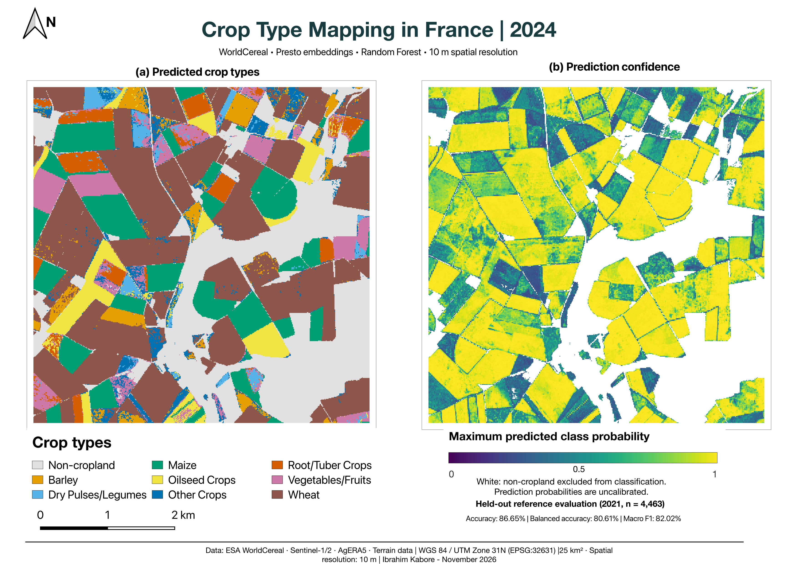

# WorldCereal crop type mapping with Presto and Random Forest

An independent practical extension of the ESA 14th Advanced Training Course on Land Remote Sensing (2025), completed by Ibrahim Kabore in November 2026. The project produces a 10 m crop-type map and model-confidence map for a 25 km² demonstration area in France in 2024.

## Method

1. Train a baseline on the course-provided 128-dimensional Presto embeddings, withholding reference sources (`ref_id`).
2. Use the August 2026 WorldCereal seasonal Presto encoder through PromethEO, with frozen weights. Encode January to December observations and average April to August temporal embeddings. Use the same preprocessing for reference samples and spatial inputs; mask B8A and preserve missing observations.
3. Retain complete calendar windows with at least six observable months. Of 48,452 original reference samples, 12,393 pass the selection (7,930 training; 4,463 held-out 2021 French LPIS samples). Train the Random Forest and histogram gradient boosting classifiers on the 128 features.
4. Generate 128-D embeddings for the 500 × 500 pixel 2024 cube, use the pretrained WorldCereal land-cover head to mask non-cropland, and classify the remaining crop pixels with the fitted Random Forest. Export crop codes, maximum class probability and cropland mask as GeoTIFFs. Prepare the final layout in QGIS.

## Results

| Experiment | Accuracy | Balanced accuracy | Macro F1 |
| --- | ---: | ---: | ---: |
| 2025 baseline RF, full held-out set (n=13,390) | 80.83% | 62.56% | 65.89% |
| 2025 baseline RF, matched subset (n=4,463) | 79.25% | 66.79% | 69.11% |
| 2026 seasonal RF, matched subset (n=4,463) | 86.65% | 80.61% | 82.02% |
| 2026 seasonal histogram gradient boosting (n=4,463) | 86.56% | 79.53% | 81.52% |

The matched comparison controls the evaluation samples but not the training set, encoder or seasonal pooling. It is not an isolated checkpoint ablation. The 2024 map has no independent local accuracy assessment; the stated metrics are for held-out 2021 reference samples. Maximum class probabilities are uncalibrated, and potential overlap with foundation-model pretraining has not been verified.

## Reproduce the workflow

Run the four [notebooks](notebooks/) in order in Google Colab, preferably with a GPU for Notebook 02 (the experiment used an NVIDIA L4). Notebook 01 creates the reference-group split and baseline manifest required by Notebook 02. Install dependencies in the notebooks and retain the same scikit-learn version for model loading in Notebook 04. The WorldCereal dependency is pinned to a repository revision in Notebook 02 and the encoder fingerprint is verified before inference.

Place the ESA course inputs in Google Drive under `MyDrive/ESA_EO_Projects/WorldCereal_Crop_Mapping/data/`:

- `extractions.parquet`
- `training_df.parquet`
- `processed_training_df.parquet`
- `worldcereal-preprocessedinputs-french-demo.nc`

The course datasets, model checkpoints, generated embeddings and fitted model files are **not redistributed** here. Obtain these inputs from the course or their original providers. The notebooks write results to Drive; the published figure is the completed QGIS layout. The repository versions include a CRS recovery check in Notebook 04 for NetCDF files lacking readable CRS metadata.

## Deliverables

- [Final map (PDF)](figures/WorldCereal_Map.pdf)
- [QGIS crop palette](qgis/worldcereal_crop_style.qml)
- Four annotated notebooks for baseline evaluation, embedding extraction, classification and mapping.

## Sources and credit

- [ESA EO College course](https://eo-college.org/courses/14th-advanced-training-course-on-land-remote-sensing/)
- [WorldCereal classification](https://github.com/WorldCereal/worldcereal-classification)
- [PromethEO](https://github.com/WorldCereal/prometheo)
- [WorldCereal paper](https://doi.org/10.5194/essd-15-5491-2023)
- [Presto paper](https://arxiv.org/abs/2304.14065)

Input modalities: Sentinel-1 SAR, Sentinel-2 optical observations, AgERA5 meteorology, terrain elevation and slope. The study area uses WGS 84 / UTM zone 31N (EPSG:32631). This is an educational portfolio project, not an official WorldCereal product.
