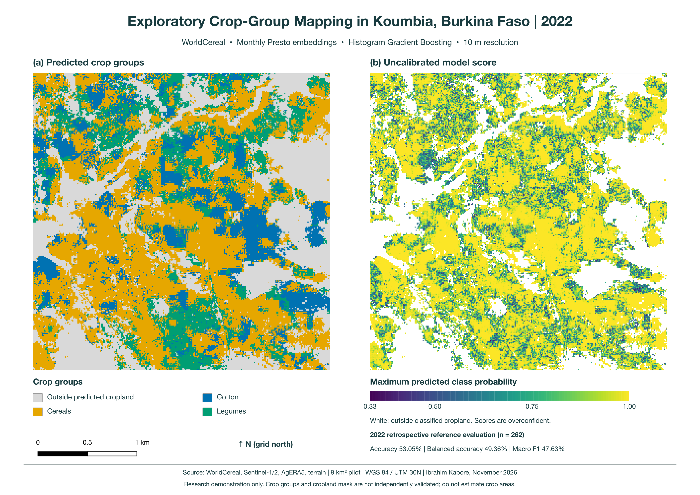

# Evaluating Earth observation foundation models for smallholder crop mapping in Burkina Faso

Independent educational research project, Ibrahim Kabore, November 2026. This extension of the France practical investigates whether a frozen global WorldCereal Presto encoder transfers to Koumbia. It is not an official WorldCereal product.

[Final QGIS layout (PDF)](../figures/Koumbia_2022.pdf)

## Dataset and method

- JECAM-CIRAD field data and WorldCereal public preprocessed extractions for 2017, 2018, 2020, 2021 and 2022. Selected 1,525 observations (18,300 monthly rows) covering six single-crop classes.
- 992 observations from 2017/2018/2020 for training, 271 from 2021 for candidate selection, 262 from 2022 for retrospective evaluation. Locations may recur across years; temporal splits are not spatially independent. Separate five-fold spatial CV uses 2 km blocks and a 100 m exclusion buffer; leave-year-out tests historical temporal transfer.
- Frozen August 2026 global seasonal Presto encoder via PromethEO; Jan-Dec context, B8A and radar masked in optical configurations. Radar was absent in 2020/2021 extractions. Compared 128-dimensional seasonal means, 384-dimensional stage means, 768-dimensional concatenated May-Oct vectors and 86 conventional spectral/index/weather/terrain features. Compared Random Forest, Histogram Gradient Boosting and logistic regression.
- Six-crop target: cotton, cowpea, groundnut, maize, sorghum, soybean. Three-group target: cereals (maize/sorghum), legumes (cowpea/groundnut/soybean), cotton. Other crops are outside the scheme.

## Results

Six-crop original optical HGB macro F1: 0.2704 on 2021 and 0.2722 on 2022. Conventional spectral HGB improved 2021 macro F1 to 0.3262 but yielded 0.2255 in leave-year-out CV; seasonal Presto HGB achieved 0.3016 in temporal CV. Sorghum and groundnut recall remained low. Three-group classification is a different, easier prediction task.

The monthly Presto + HGB model was selected on 2021 macro F1, ahead of balanced HGB (0.6477) and the best conventional spectral configuration (0.5941). Original three-group conventional HGB achieved 0.5871.

| Selected monthly Presto + HGB | Accuracy | Balanced accuracy | Macro F1 |
|---|---:|---:|---:|
| 2021 validation (n=271) | 66.05% | 65.93% | 65.23% |
| 5-fold spatial CV, 100 m buffer (mean) | 69.66% | 65.41% | 65.89% |
| 3-fold leave-year-out CV (mean) | 61.46% | 58.40% | 56.46% |
| 2022 retrospective (n=262) | 53.05% | 49.36% | 47.63% |

The 2022 result is retrospective because the year was already examined for the six-crop task. Cereals recall was 90.1%, cotton 25.0%, legumes 33.0%; 64% of cotton observations and 61% of legumes were mislabelled cereals. The highest-score bin (193 observations) had mean score 98.2% but observed accuracy 57.5%. Scores are uncalibrated.

## Spatial demonstration (2022)

The final notebook requests a 3 × 3 km pilot cube from Copernicus Data Space openEO using the pinned WorldCereal preprocessor. The cube has 12 months, 300 × 300 pixels, EPSG:32630, 10 m grid. The global annual cropland head supplies a provisional mask. The classifier predicts over 63,816 masked-in pixels that pass the optical coverage filter.

| Code | Prediction | Pixels |
|---:|---|---:|
| 0 | Outside predicted cropland | 26,184 |
| 1 | Cereals | 36,116 |
| 2 | Cotton | 13,352 |
| 3 | Legumes | 14,348 |
| 255 | Unclassified | 0 |

These are prediction counts, not validated crop area estimates. The cropland mask and wall-to-wall map have no independent local validation. Other crop types may be assigned incorrectly. The pilot does not represent the whole commune or Burkina Faso.

## Reproduce in Colab

Run in order. GPU required for 07, 08B, 08C and 09.

1. [05 Reference data](../notebooks/burkina/05_Burkina_Reference_Data.ipynb)
2. [06 EO extractions](../notebooks/burkina/06_Burkina_EO_Extraction.ipynb)
3. [07 Presto embeddings](../notebooks/burkina/07_Burkina_Presto_Embeddings.ipynb)
4. [08 Six-crop classification](../notebooks/burkina/08_Burkina_Crop_Classification.ipynb)
5. [08B Feature comparison](../notebooks/burkina/08B_Burkina_Model_Improvement.ipynb)
6. [08C Three-group model](../notebooks/burkina/08C_Burkina_Crop_Group_Classification.ipynb)
7. [09 Spatial inference](../notebooks/burkina/09_Burkina_Spatial_Crop_Group_Mapping.ipynb)

Notebook 09 requires a Copernicus Data Space account and consumes openEO credits. Set SUBMIT_JOB=True explicitly when ready. It saves a job ID and reuses downloaded data. CF decoding respects unsigned values and missing-value metadata. Use the checkpoint and scikit-learn version recorded in the classifier manifest. Outputs: prediction, raw score, cropland mask, optical quality mask and provenance.

## Cartography

The [QGIS layout builder](../qgis/build_koumbia_layout.py) expects crop_groups_2022.tif and crop_group_raw_score_2022.tif from Notebook 09. Run it using the QGIS Python interpreter:

    QT_QPA_PLATFORM=offscreen /Applications/QGIS.app/Contents/MacOS/python qgis/build_koumbia_layout.py /path/to/pilot_outputs /path/to/layout_output

The builder copies the rasters into the layout directory, creates an editable QGIS project, and exports a PDF and PNG with matching extents, class palette, raw-score ramp, scale bar, grid north, evaluation metrics and limitations. Raw source data and fitted models are not redistributed.

## Sources and credit

- [JECAM-CIRAD field reference data paper](https://doi.org/10.5194/essd-13-5951-2021)
- [JECAM GeoParquet distribution](https://source.coop/fiboa/data/jecam)
- [WorldCereal reference data module](https://rdm.esa-worldcereal.org/)
- [WorldCereal classification](https://github.com/WorldCereal/worldcereal-classification) and [PromethEO](https://github.com/WorldCereal/prometheo)
- [Presto](https://arxiv.org/abs/2304.14065)
- [Copernicus Data Space](https://dataspace.copernicus.eu/)

AI-assisted implementation; Colab execution, output inspection and evaluation by Ibrahim Kabore. Presto and WorldCereal are upstream research software, not models developed by the author.
